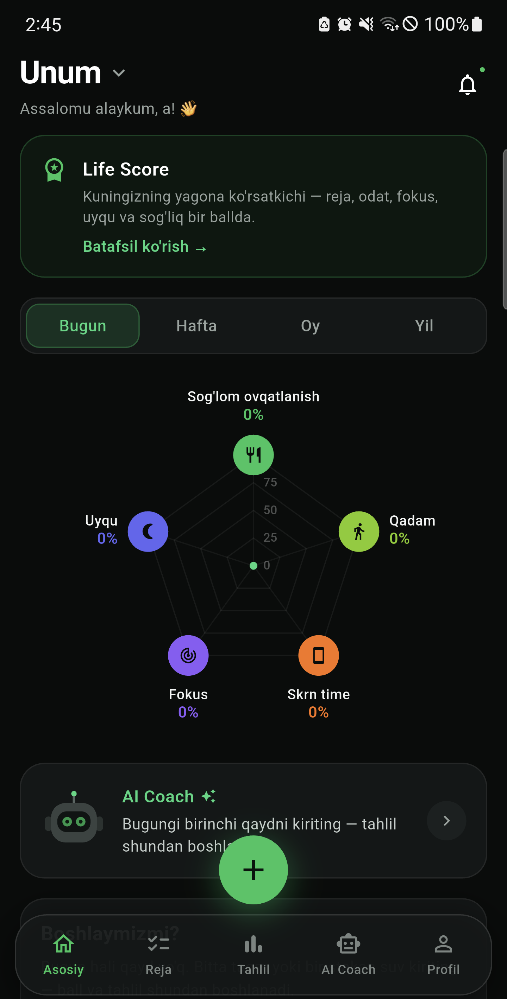
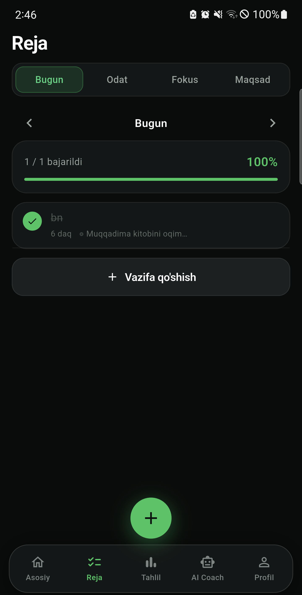
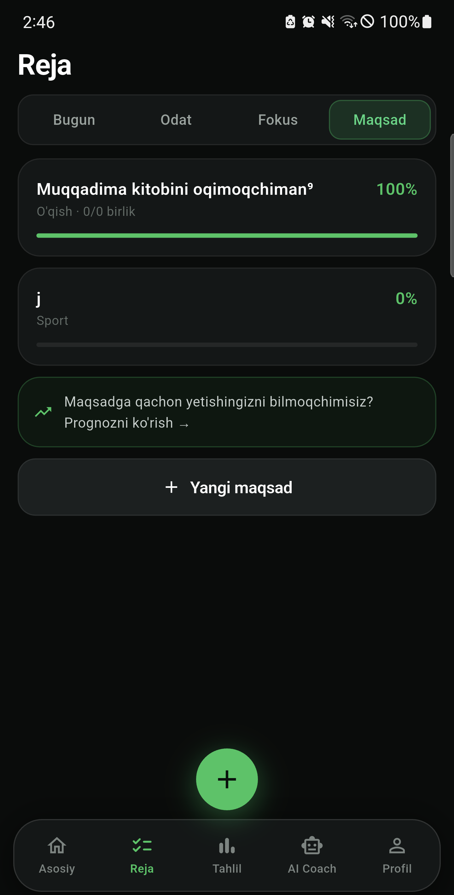
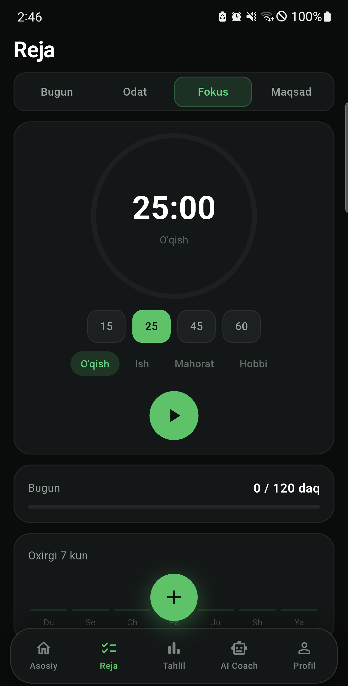
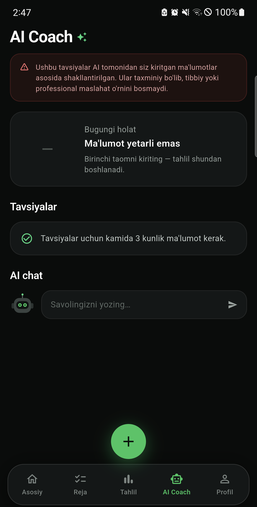

# UNUM

**Shaxsiy operatsion tizim.** Maqsad, kunlik reja, odat, fokus va sog'liq —
bitta ilovada, bitta raqamga jamlanadi: **Life Score (0–100)**.

O'zbek tilida, O'zbekiston uchun: mahsulot narxlari so'mda, ovqat bazasi
milliy taomlardan tuzilgan.

| | |
|---|---|
| Platforma | Android (Flutter) · iOS (tayyorlanmoqda) · Web |
| Backend | Node.js + Express + TypeScript + SQLite |
| Paket nomi | `uz.unum.app` |
| Versiya | 1.1.0 (build 3) |

---

## ▶︎ Demo — ishlaydigan ilovani sinab ko'rish

**[⬇︎ UNUM 1.1.0 · APK yuklab olish](../../releases/latest)** — Android 8.0+, 53 MB

Bu haqiqiy, to'liq ishlaydigan ilova: ro'yxatdan o'tib, maqsad qo'yib,
kunni rejalashtirib, Life Score'ni ko'rishingiz mumkin.

**O'rnatish:** APK'ni yuklab oling → oching → Android "noma'lum manbadan
o'rnatish" so'rasa ruxsat bering. Kirish **Google hisobi** orqali.

> **Nega Play Market'dan emas?**
> Ilova Play Market'da chiqarish jarayonida. Google shaxsiy dasturchi
> hisoblari uchun yangi ilovani majburiy **yopiq test bosqichidan**
> o'tkazadi (kamida 12 ta tester, 14 kun uzluksiz) — shundan keyin
> produksiyaga chiqariladi. iOS versiyasi tayyorlanmoqda.
>
> Shu sabab ko'rib chiqish uchun bu yerga to'g'ridan-to'g'ri o'rnatiladigan
> APK qo'yilgan.

### Ekranlar

<p align="center">
  
  
  
  
  
</p>
<p align="center">
  <sub>Life Score · Kunlik reja · Maqsadlar · Fokus · AI kouch</sub>
</p>

---

## Nima qiladi

**Maqsad → vazifa → odat** zanjiri. Katta maqsad AI yordamida bosqichlarga
bo'linadi, bosqichlar kunlik vazifaga aylanadi, takrorlanadigani odatga
o'tadi. Har biri bir-biriga bog'lanadi — alohida ro'yxatlar emas.

**Life Score.** Kun oxirida bitta raqam: bugun qanday o'tdi. Oltita
komponentdan yig'iladi (vazifa 20, odat 20, sog'liq 25, fokus 15, uyqu 10,
maqsad 10).

**Fokus.** Pomodoro taymer; sarflangan chuqur ish vaqti ballga qo'shiladi.

**Sog'liq.** Ovqat (rasmdan AI tahlili), suv, uyqu, qadam. Qadam va uyqu
**Health Connect** orqali avtomatik olinadi — qo'lda kiritish shart emas.

**Ekran vaqti.** Android `UsageStatsManager` orqali kunlik jami hisoblanadi.

**AI kouch.** Foydalanuvchining haqiqiy raqamlarini ko'radi va shu asosda
javob beradi; umumiy maslahat bermaydi.

**Haftalik/oylik hisobot.** Nima o'sdi, nima tushdi, maqsadga ulgurasizmi.

---

## Loyiha tuzilishi

```
UNUM/
├── server.ts        Express backend — barcha marshrutlar
├── auth.ts          JWT, ro'yxatdan o'tish, hisobni o'chirish
├── oauth.ts         Google / Apple bilan kirish
├── db.ts            SQLite sxemasi (better-sqlite3, WAL)
│
├── goals.ts         Maqsadlar + bosqichlar
├── tasks.ts         Kunlik vazifalar
├── habits.ts        Odatlar + ketma-ketlik (streak)
├── focus.ts         Fokus seanslari
├── lifescore.ts     Life Score — og'irliklangan 6 komponent
├── review.ts        Haftalik hisobot + maqsad bashorati
├── coach.ts         AI kouch va maqsadni bosqichlarga bo'lish
│
├── day.ts           Vaqt mintaqasiga to'g'ri kun kaliti
├── sanitize.ts      Kirish ma'lumotlarini server tomonda cheklash
├── foods.ts         132 ta o'zbek mahsuloti va taomi
├── billing.ts       Obuna rejalari va chegaralar
├── click.ts         To'lov qatlami (public repoda qisqartirilgan)
│
├── bot/             Telegram bot
├── public/          Landing, maxfiylik siyosati, hisobni o'chirish
├── store/           Play Market grafikalari va listing matni
├── mobile/          Flutter ilova (48 ta Dart fayli)
└── unum/            Veb versiya (React + Vite)
```

---

## Muhandislik yechimlari

Bu loyihada ataylab qabul qilingan, izohlanishi kerak bo'lgan qarorlar:

**Hisoblangan qiymatlar faqat serverda.** Progress, streak, Life Score —
hammasi backend'da hisoblanadi. Flutter ularni qayta hisoblamaydi, faqat
ko'rsatadi. Aks holda ilova va Telegram bot bir xil kun uchun turli raqam
ko'rsatardi.

**Kun — vaqt mintaqasi bo'yicha, UTC emas** (`day.ts`). Ilgari server kunni
UTC'da hisoblardi; natijada 00:00–05:00 orasida ilova va bot boshqa-boshqa
ball ko'rsatardi.

**Kirish ma'lumotlari server tomonda cheklanadi** (`sanitize.ts`). Har bir
maydonda chegara bor (qadam ≤120 000, suv ≤5 000 ml, uyqu ≤16 soat) va
undan tashqari **kunlik jamiga ham** chegara qo'yilgan — bitta yozuv
chegaradan o'tsa ham, ko'p yozuv qo'shib jamini shishirib bo'lmaydi.

**Yo'q ma'lumot jazolamaydi.** Life Score mavjud komponentlar bo'yicha
og'irliklarni qayta taqsimlaydi. Uyquni yozmagan odam nol olmaydi.

**Bashorat o'ylab topilmaydi** (`review.ts`). "72% ehtimol" kabi raqam
chiqarilmaydi; o'rniga *kerakli sur'at* va *haqiqiy sur'at* solishtiriladi.

**Sog'liq ma'lumoti faqat o'qiladi.** Ilova Health Connect'ga hech narsa
yozmaydi. Ruxsat bo'lmasa `null` qaytadi — nol emas, chunki nol
"bugun umuman yurmadingiz" degan yolg'on ko'rsatkich berardi.

**Ekran vaqti — faqat jami.** `UsageStatsManager` dan qaysi ilova qancha
ishlatilgani **o'qilmaydi**; qurilmadan faqat umumiy daqiqa chiqadi.

---

## Ishga tushirish

**Backend**

```bash
cp .env.example .env      # OPENAI_API_KEY va JWT_SECRET to'ldiring
openssl rand -hex 32      # JWT_SECRET uchun
npm install
npm run dev               # http://localhost:3000
```

**Mobil ilova**

```bash
cd mobile
flutter pub get
flutter run
```

Backend manzili `mobile/lib/config.dart` da yoki build vaqtida:

```bash
flutter build apk --release --dart-define=BACKEND_URL=https://example.com
```

---

## Testlar

```bash
npm test                              # backend: 7 ta to'plam
npx tsc --noEmit                      # tiplar
cd mobile && flutter analyze && flutter test
```

Backend to'plamlari: kun kaliti, maqsad, vazifa, odat, fokus, Life Score,
hisobot. Flutter tomonda: ball formulasi, ustunlar, tahlil, widget.

---

## Xavfsizlik

- `JWT_SECRET` majburiy — bo'lmasa server production'da ishga tushmaydi.
- Integratsiya tokenlari bazada AES-256-GCM bilan shifrlanadi.
- Rate limit: auth 12/15daq (IP), AI 60/kun (hisob), umumiy API 240/daq,
  to'lov 20/soat.
- Hisobni o'chirish barcha yozuvlarni CASCADE orqali o'chiradi.
- Ovqat rasmi tahlil uchun OpenAI'ga yuboriladi, **saqlanmaydi** va unga
  ism/email biriktirilmaydi.

---

## Ochiq repozitoriy haqida

Bu repozitoriy loyihani ko'rsatish uchun ochilgan. Undan ataylab
chiqarib tashlangan narsalar:

- `.env` — barcha API kalitlari va tokenlar
- `unum.db` — haqiqiy foydalanuvchi ma'lumotlari
- Android imzo kaliti va uning parollari
- Serverga joylashtirish skriptlari va ichki manzillar
- To'lov provayderi integratsiyasining haqiqiy kodi (`click.ts` da faqat
  interfeys qoldirilgan)

Kod tuzilishi va mantig'i to'liq ko'rinadi; ishga tushirish uchun o'z
kalitlaringiz kerak bo'ladi.

---

## Litsenziya

© 2026 UNUM. Barcha huquqlar himoyalangan.

Kod namoyish va ko'rib chiqish uchun ochiq. Tijoriy foydalanish, nusxalash
yoki hosila ish yaratish — mualliflik ruxsatisiz taqiqlanadi.
